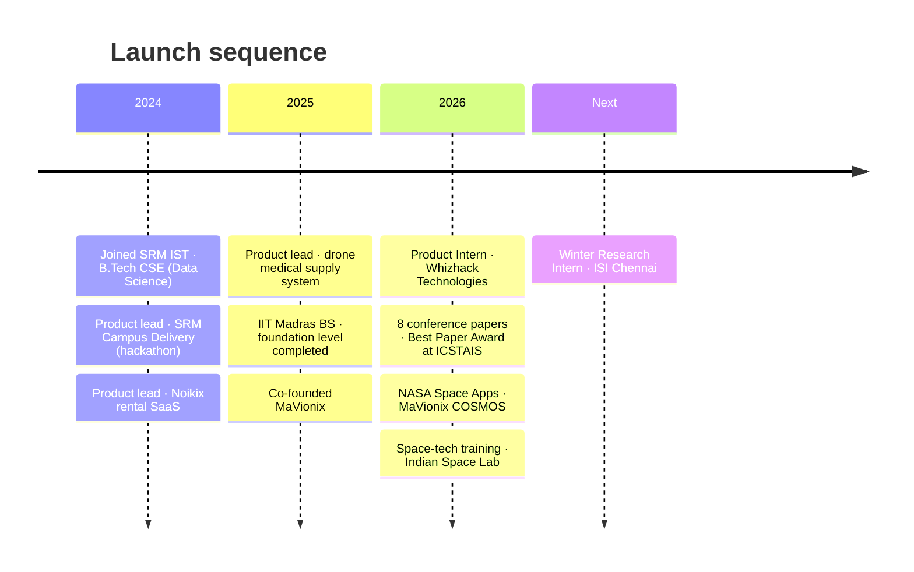

<!-- ===================== HEADER ===================== -->
<p align="center">
  
</p>

<p align="center">
  <a href="https://git.io/typing-svg">
    
  </a>
</p>


<p align="center">
  
  
  
  
</p>

<p align="center"></p>

<!-- ===================== ABOUT ===================== -->
## 🧑‍🚀 Crew Manifest

I work where **artificial intelligence meets space science and product thinking**: I co-found AI products at **[MaVionix](https://mavionix.in)**, and I research how machine learning can read the universe, from planetary spectra to the formation of the earliest galaxies.

```python
class AstroAIProductResearcher:
    name       = "Vishant Bhardwaj"
    callsign   = "@Vishantbhardwaj18"
    home_base  = "Earth 🌍 · India"
    roles      = ["Co-Founder @ MaVionix", "Astro-AI Researcher", "YouTube Creator"]
    education  = {
        "SRM IST":    "B.Tech CSE (Data Science)",
        "IIT Madras": "BS Management & Data Science",
    }
    orbiting   = [
        "Early galaxy formation  ·  JWST + ALMA",
        "Photometric redshifts   ·  SDSS DR17, DESI DR1",
        "Planetary spectra       ·  Spectrastro",
    ]
    next_stop  = "Winter Research Intern @ ISI Chennai (Dec 2026)"
    ask_me     = ["AI for astronomy", "Product management", "MVPs", "User research", "Startups"]
    fun_fact   = "Turns ideas into products… and still believes he's funny 😄"

    def mission(self):
        return "Use AI to read the universe, and turn ideas into products people use 🚀"
```

📝 I also write about product & startups → [vishantbhardwaj.blogspot.com](https://vishantbhardwaj.blogspot.com/)

<!-- ===================== FOCUS ===================== -->
## 🎯 Focus Areas

<p align="center">
  <b>🤖 AI</b><br/>
  
  
  
  
  
  
  <br/><br/>
  <b>🔭 Astro & Space</b><br/>
  
  
  
  
  
  
  <br/><br/>
  <b>🧭 Product</b><br/>
  
  
  
  
  
</p>

<p align="center"></p>

<!-- ===================== FLIGHT PATH ===================== -->
## 🛰️ Flight Path



<details>
<summary><b>📋 Full mission log</b></summary>
<br/>

| | Mission | Role | Timeline |
|:-:|---|---|---|
| 🚀 | **MaVionix India Pvt Ltd** | Co-Founder: AI SaaS for SMEs, ARAK-1 pipeline-inspection robot, drone delivery | Jul 2025 – Present |
| 📊 | **Indian Statistical Institute (ISI), Chennai** | Winter Research Intern: statistical modelling & data-driven inference | Dec 2026 – Jan 2027 |
| 🛰️ | **Indian Space Lab** | Winter Intern & Trainee: space technology | Nov 2026 – Dec 2026 |
| 🔐 | **Whizhack Technologies** | Product Intern: cybersecurity pre-sales, RFPs, POCs | May 2026 – Jul 2026 |
| 🎙️ | **TSBM Society, SRM-IST Delhi-NCR** | Vice President & Lead, Research, Publications and Thought Leadership | Oct 2026 – Present |

</details>

<!-- ===================== RESEARCH ===================== -->
## 🔭 Research Orbit

<details open>
<summary><b>📄 Journal papers (under review)</b></summary>
<br/>

- Physics-Informed Multimodal Simulation-Based Inference of Early Galaxy Formation Histories from JWST and ALMA
- Calibrated Probabilistic Photometric Redshifts from Sky-Disjoint Validation of Gradient-Boosted Ensembles on SDSS DR17, with a Pantheon+SH0ES Late-Universe Baseline
- Selection-Aware Photometric Redshift Estimation with Deep Mixture-Density Networks Using DESI DR1

</details>

<details>
<summary><b>🎤 Conference papers, all 8 accepted & presented in 2026 (click to expand)</b></summary>
<br/>

- **Spectrastro**: a multi-modal, database-integrated deep learning framework for planetary spectral data analysis (*ACIFFS 2026*, Manipal University Jaipur)
- **MaVionix**: a low-power AI-enabled platform for sustainable digital services in rural enterprises (*ICSTAIS 2026*, Chandigarh University) 🏆
- AI-driven EDA optimization for VLSI design automation using multi-stage deep reinforcement learning (*ICETT 2026*, NIT Jalandhar)
- A multi-modal AI framework for safety intelligence in heavy-duty trucks using computer vision, IoT sensor fusion and explainable AI (*ICSIE 2026*)
- Smart obstacle detection system for visually impaired navigation using ultrasonic sensing (*ICSIE 2026*)
- **SensePath**: a low-cost multi-sensor assistive cane with real-time hazard prioritization for the visually impaired (*NCPTSD-26*)
- **MVediScan AI**: a deep learning-based mobile diagnostic assistant for multi-modal medical analysis (*NCPTSD-26*)
- Machine learning-based optimization of digital logic gate networks for power and delay reduction (*ACIFFS 2026*, Manipal University Jaipur)

</details>

<details>
<summary><b>📜 Patents: 4 Indian design applications, co-applicant (2026)</b></summary>
<br/>

- Smart Robotic Pipeline Maintenance Device
- Intelligent Walking Assistance Cane Device
- Smart Terratrain Rescue Hexapod Robotic Device
- AI-Enabled IoT System for Rural Enterprises Device

</details>

<p align="center"></p>

<!-- ===================== PROJECTS ===================== -->
## 🚀 Launchpad

| | Project | What it does | Domain |
|:-:|---|---|---|
| 🌌 | **Spectrastro** | Deep learning on planetary spectral data, backed by an integrated spectral database | Astro-AI |
| 🛰️ | **MaVionix COSMOS** | NASA Space Apps Challenge 2026 project: *Planet X and SPHEREx* | Space |
| 🌡️ | **UrbanCoolSim** | Urban-heat digital-twin platform | Climate |
| 🤖 | **ARAK-1** | Quadruped robot for pipeline inspection and crack detection | Robotics |
| 🦯 | **SensePath** | Low-cost multi-sensor assistive cane with real-time hazard prioritization | Assistive tech |
| 🩺 | **MVediScan AI** | Deep-learning mobile assistant for multi-modal medical analysis | HealthTech |
| 🚁 | **Drone Medical Supply** | Autonomous drone delivery of medical supplies to remote army zones | Defense |

<p align="center"></p>

<!-- ===================== ACHIEVEMENTS ===================== -->
## 🏆 Hall of Fame

<div align="center">

<table>
<tr>
<td align="center" width="33%">🥇<br/><b>Best Paper Award</b><br/><sub>ICSTAIS 2026 · IEEE</sub></td>
<td align="center" width="33%">🏅<br/><b>Winner, Avinya 2026</b><br/><sub>IIT Guwahati</sub></td>
<td align="center" width="33%">🏅<br/><b>Winner, Thrust Tech Expo</b><br/><sub>IIT Hyderabad</sub></td>
</tr>
<tr>
<td align="center">🏅<br/><b>Winner, Innovathon 1.0</b><br/><sub>University of Jammu</sub></td>
<td align="center">🎖️<br/><b>Appreciation Prize</b><br/><sub>Anveshana, New Delhi</sub></td>
<td align="center">🌍<br/><b>Guinness World Record</b><br/><sub>Longest Painting by Numbers</sub></td>
</tr>
</table>

</div>

<p align="center"></p>

<!-- ===================== SKILLS ===================== -->
## 🧰 Tech Stack

<p align="center">
  <b>Languages</b><br/>
  <br/><br/>
  <b>AI / ML & Data</b><br/>
  <br/><br/>
  <b>Cloud, DevOps & Databases</b><br/>
  <br/><br/>
  <b>Hardware, Product & Tools</b><br/>
  
</p>

<p align="center"></p>

<!-- ===================== STATS ===================== -->
## 📊 Telemetry

<p align="center">
  
</p>

<p align="center">
  
  
</p>

<!-- Snake: built by .github/workflows/snake.yml into the "output" branch -->
<h3 align="center">🐍 Contribution Snake</h3>
<p align="center">
  <picture>
    <source media="(prefers-color-scheme: dark)" srcset="https://raw.githubusercontent.com/Vishantbhardwaj18/Vishantbhardwaj18/output/github-snake-space.svg"/>
    <source media="(prefers-color-scheme: light)" srcset="https://raw.githubusercontent.com/Vishantbhardwaj18/Vishantbhardwaj18/output/github-snake.svg"/>
    
  </picture>
</p>

<p align="center"></p>

<!-- ===================== CONNECT ===================== -->
## 🌍 Let's Connect & Collaborate

<p align="center">
  
</p>

<p align="center">
  <a href="https://linkedin.com/in/vishant-bhardwaj"></a>
  <a href="https://www.youtube.com/@vishant_bhardwaj"></a>
  <a href="https://instagram.com/vishant_bhardwaj_18"></a>
  <a href="https://twitter.com/vishantgamerz"></a>
</p>

<p align="center">
  <a href="https://mavionix.in"></a>
  <a href="https://vishantbhardwaj.blogspot.com/"></a>
  <a href="https://kaggle.com/vishantbhardwaj18"></a>
  <a href="https://leetcode.com/vishantbhardwaj"></a>
  <a href="mailto:vishantbhardwaj06@gmail.com"></a>
</p>

<p align="center">
  <a href="https://github.com/vishantbhardwaj18?tab=repositories"></a>
</p>

<p align="center"><i>If you like what I build, a ⭐ on a repo truly helps and keeps me launching more 🚀</i></p>

<p align="center"><b>Built on Earth 🌍 · Aimed at the Galaxies✨</b></p>

<p align="center">
  
</p>
